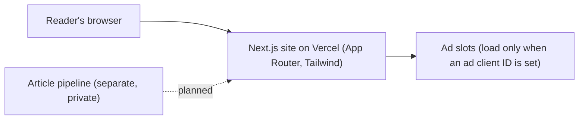
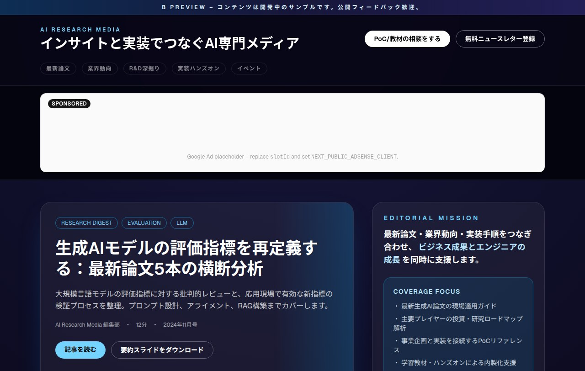

# AI Research Media

> Working name; trademark and domain checks pending.

**One line:** a Japanese-language web media site that explains new AI papers and industry moves for engineers and business teams, and leads readers who want to build something to proof-of-concept support and learning material.

## The problem
New AI papers and product announcements arrive every week, mostly in English and mostly written for researchers. Engineers and planners in Japanese companies need the parts that matter for their work: what changed, whether it is usable, and how to try it.

## What it is (today)
- A design prototype of the site: a front page with a lead article, weekly picks, trend notes per company, an event list and a newsletter sign-up.
- A clear **beta-preview banner**: every article on the page is sample text written to try the layout, not published reporting.
- Revenue paths built into the layout: a proof-of-concept consultation call to action, learning-material subscriptions, sponsor material requests, and ad slots that load only when an ad account is configured.

## How it is built

Next.js App Router with Tailwind CSS, deployed on Vercel. Articles are written into the page today; feeding them from a local article-generation pipeline is planned.

## Status
| Verified | How |
|---|---|
| The site builds and is served | the beta preview is live on Vercel (checked 2026-10-12) |
| Not verified | |
| Article pipeline | not connected; all articles are sample text |
| Ads, newsletter, consultation form | placeholders; no ad account, form or mailing list is connected |
| Audience, revenue | none yet |

## Screen

*Front page of the beta preview. The headline article is sample text; the ad slot is a placeholder.*

*Source is private and can be shared on request when we discuss a project. Part of [Happy AI Garage](https://github.com/johnknash2025).*
